  

  

  
  
  

🎓 CS student at UT Dallas, transferred from the University of Ottawa  
🔭 working on [planet-or-binary](https://github.com/aparnabalaji07/planet-or-binary), an ML classifier for exoplanet transits in TESS data  
☀️ embedded team lead on an industry-sponsored solar tracker through Comet Robotics  
📄 co-authored two papers on binary star systems in the Journal of Double Star Observations  
🌱 looking for Summer 2027 internships and undergrad research in astronomy

| project                                                                        | what it is                                                                                                               | built with              |
| ------------------------------------------------------------------------------ | ------------------------------------------------------------------------------------------------------------------------ | ----------------------- |
| 🪐 [planet or binary](https://github.com/aparnabalaji07/planet-or-binary)      | sorts TESS transit signals into planets and eclipsing binaries                                                           | Python                  |
| 🧠 [AI skill gap analyzer](https://github.com/ieee-utd/cis-skill-gap-analyzer) | IEEE UTD project I lead that compares a student's skills to what roles ask for                                           | Python, LLM API, pandas |
| ☀️ Janta Power solar tracker                                                   | industry-sponsored solar tracker where I lead the embedded team creating the circuitry and writing the sun position code | C++, embedded systems   |
| 📈 [market simulator](https://github.com/aparnabalaji07/market-simulator)      | backtesting engine for trading strategies with a guard against look-ahead bias                                           | Python                  |
| 📷 ESP32 digital camera                                                        | a camera I built that takes photos and saves them to a MicroSD card                                                      | C++, Arduino            |
| 🐶 [adoption bio generator](https://adoption-bio-generator.vercel.app/)        | turns a shelter pet's info into an adoption bio                                                                          | React, Claude API       |

 
          
 
             
 
       
  
   
 
  
 
  

